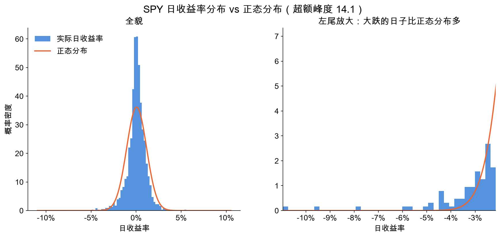
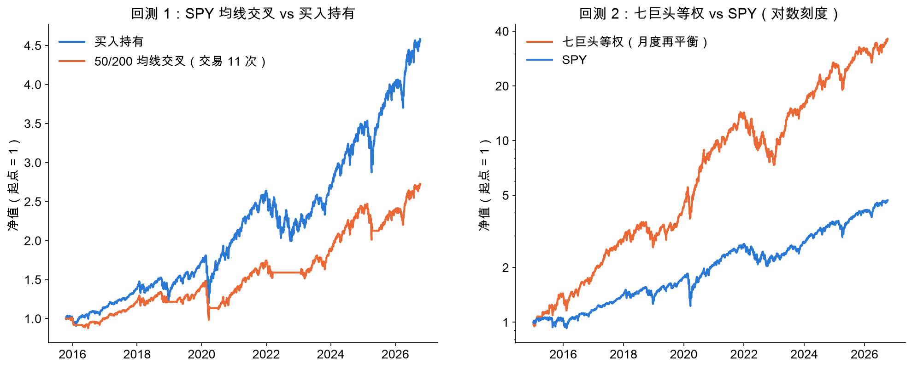
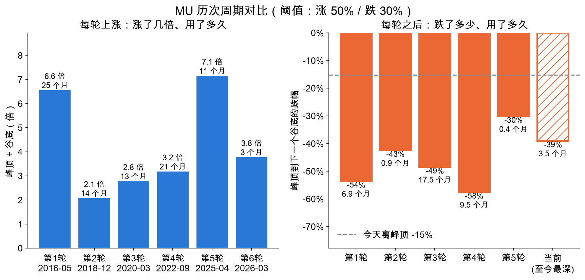
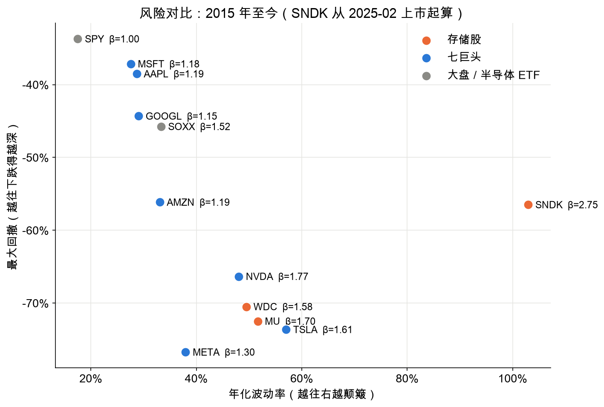
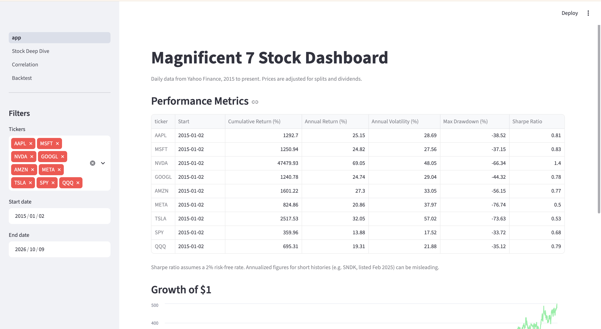
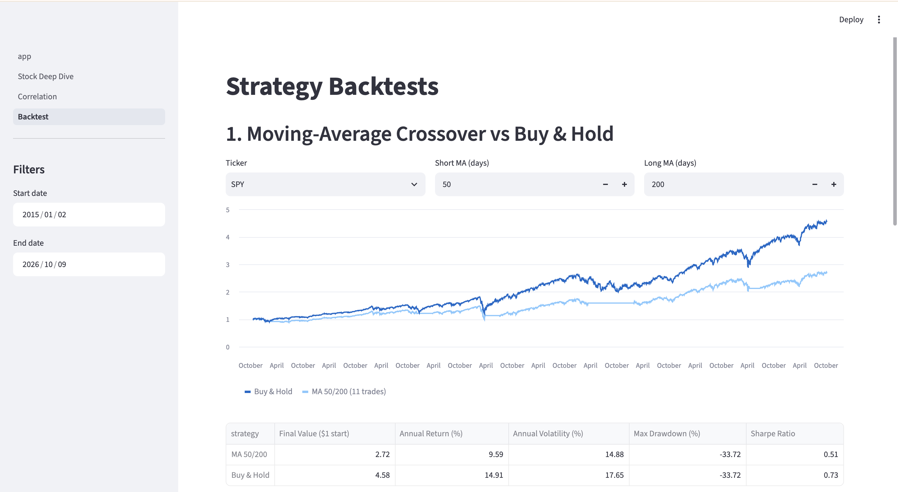

# Magnificent 7 Stock Analysis & Backtesting Dashboard
# 美股科技七巨头数据分析与回测看板

**🔗 Live dashboard / 在线看板：https://cyrus-mag7-dashboard.streamlit.app/**
(Free hosting: if the app has been idle, it may take about 30 seconds to wake up. 免费托管，长时间没人访问会休眠，打开时需等约 30 秒唤醒。)

## Overview / 项目简介

An end-to-end data analysis project on the "Magnificent 7" US tech stocks
(AAPL, MSFT, NVDA, GOOGL, AMZN, META, TSLA), benchmarked against SPY and QQQ.
Daily prices from January 2015 onward are downloaded with yfinance, stored in MySQL,
analysed with Pandas, and presented in an interactive Streamlit dashboard.
The project asks three questions: How do these stocks trade off return against risk?
Do their returns behave like a normal distribution? Can a simple trading rule beat buy-and-hold?
A separate module asks whether memory-chip stocks are still cyclical after the AI-driven rally of 2025–26.

一个端到端的数据分析项目：以美股科技七巨头为对象，以 SPY、QQQ 为基准。
用 yfinance 下载 2015 年 1 月至今的日度数据，存入 MySQL，用 Pandas 分析，最后做成可交互的 Streamlit 看板。
项目回答三个问题：这些股票的收益和风险如何权衡？收益率是否服从正态分布？简单的交易规则能否跑赢买入持有？
另有一个模块研究：经过 2025–26 年 AI 需求带来的大涨，存储芯片股是否仍是周期股。

## Key Findings / 主要发现

Sample: 2 Jan 2015 – 9 Oct 2026, 13 tickers, 35,930 daily rows. Re-running the fetch script downloads newer data, so your numbers will differ slightly.
样本：2015-01-02 至 2026-10-09，13 只标的，35,930 行日度数据。重新运行取数脚本会拿到更新的数据，数字会略有不同。

| | Finding | 发现 |
|---|---|---|
| Risk & return | NVDA has the highest Sharpe ratio (1.40, 69% a year); SPY's is 0.68. Every Mag 7 stock had a drawdown of at least 37%. | NVDA 夏普最高（1.40，年化 69%），SPY 为 0.68；七巨头最大回撤都在 37% 以上 |
| Fat tails | Daily returns are not normal: excess kurtosis is above 0 for every ticker. SPY fell more than 5% on 6 days; a normal distribution expects 0.007 such days. | 收益率不服从正态：所有标的超额峰度都大于 0。SPY 单日跌超 5% 有 6 天，正态分布下期望只有 0.007 天 |
| Correlation | Pairwise correlations among the Mag 7 range from 0.34 to 0.64. AAPL–MSFT's full-period correlation is 0.62, but its 60-day rolling correlation hit 0.95 in the 2020 sell-off. | 七巨头两两相关 0.34–0.64；AAPL–MSFT 全期 0.62，2020 年暴跌时 60 日滚动相关升到 0.95 |
| Beta | Every Mag 7 stock has a beta above 1 (NVDA 1.77). TSLA's R² is only 0.24: most of its moves are company-specific. | 七巨头 Beta 全部大于 1（NVDA 1.77）；TSLA 的 R² 只有 0.24，大部分波动来自公司自身 |
| Backtest 1 | A 50/200-day moving-average crossover underperformed buy-and-hold on all 9 tickers tested. It reduced the maximum drawdown on 7 of them (META from −77% to −38%), but not on SPY (unchanged, the 2020 crash was too fast) or AAPL (worse, after repeated false signals). | 50/200 日均线交叉在 9 个标的上收益全部低于买入持有；其中 7 个标的最大回撤下降（META 从 −77% 降到 −38%），SPY 不变（2020 年暴跌太快），AAPL 反而更大（被反复的假信号打脸） |
| Backtest 2 | An equal-weight Mag 7 portfolio rebalanced monthly turned $1 into $36, vs $4.7 for SPY. The result is inflated by survivorship bias (see Limitations). | 七巨头等权月度再平衡组合 1 美元变 36 美元，SPY 为 4.7 美元；这个结果被幸存者偏差放大了（见局限） |





More charts are in [`figures/`](figures/). 更多图表见 `figures/` 文件夹。

## Memory-Chip Cycle / 存储芯片周期

Are memory-chip stocks cyclical, or has AI demand lifted them out of the cycle? This module answers with historical
statistics only, not forecasts. It uses Micron (MU) as the main reference, with WDC, SNDK and the SOXX semiconductor ETF for comparison.
存储芯片股是周期股，还是 AI 需求让它脱离了周期？这个模块只用历史统计回答，不做预测。以美光（MU）为主要参照，WDC、SNDK 和半导体 ETF SOXX 作对比。

**Method / 方法.** A turning point is confirmed only after the price moves far enough: a trough after a 50% rise from the low,
a peak after a 30% fall from the high. One cycle = trough → peak → next trough. Thresholds are parameters of `find_turning_points()`.
转折点要等价格走得够远才确认：从低点涨超 50% 确认谷底，从高点跌超 30% 确认峰顶。一轮 = 谷底 → 峰顶 → 下一个谷底。阈值是 `find_turning_points()` 的参数。

- **MU is cyclical.** Since 2015 it has gone through 6 cycles. In each of the first four it rose 2.1–6.6x over 13–25 months, then fell 43–58%.
  Its annual volatility is 52%, three times SPY's 17.5%, with a beta of 1.70 but an R² of only 0.33: two-thirds of its moves are not explained by the market.
  **MU 是周期股**：2015 年以来 6 轮，前 4 轮每轮用 13–25 个月涨 2.1–6.6 倍，之后跌 43%–58%。年化波动率 52%，是 SPY 的 3 倍；Beta 1.70，但 R² 只有 0.33，三分之二的波动不能用大盘解释。
- **The 2025–26 rally is the largest in the sample.** From April 2025 MU rose 7.1x in 11 months, against a previous record of 6.6x in 25 months.
  Counting one 30% pull-back in March 2026 as a pause, it rose about 19x in 15 months.
  **2025–26 年这轮上涨是样本里最大的**：2025 年 4 月起 11 个月涨 7.1 倍，此前最大是 25 个月 6.6 倍；把 2026 年 3 月那次 30% 回调算作中途回调，15 个月涨了约 19 倍。
- **But the swings have not gone away.** After peaking at $1,213 in June 2026, MU fell 39% within a month, in line with past downturns (−30% to −58%).
  As of 9 Oct 2026 it is 15% below the peak and the method has not yet confirmed a trough.
  **但大起大落还在**：2026 年 6 月见顶 1213 美元后，一个月内跌 39%，与历次下跌（−30% 到 −58%）相当；截至 2026-10-09 比峰顶低 15%，谷底尚未确认。





## Dashboard / 看板

Try it online / 在线体验：https://cyrus-mag7-dashboard.streamlit.app/

| Page | Content | 内容 |
|---|---|---|
| Overview | Performance table and growth of $1 for any selection of tickers and dates | 任选股票和日期的指标表与净值曲线 |
| Stock Deep Dive | Price with 50/200-day MAs, drawdown, return distribution, beta | 单只股票：均线、回撤、收益率分布、Beta |
| Correlation | Heatmap, rolling correlation with adjustable window, CAPM table | 热力图、可调窗口的滚动相关、CAPM 回归表 |
| Backtest | MA crossover with adjustable windows; equal-weight portfolio vs SPY | 可调参数的均线策略；等权组合 vs SPY |
| Memory Cycle | Peaks and troughs with adjustable thresholds, cycle-by-cycle table, risk vs Mag 7 and SPY | 阈值可调的峰谷识别、历次周期对比表、与七巨头和 SPY 的风险对比 |





## Methods / 方法

| Metric | How it is calculated | 计算方法 |
|---|---|---|
| Daily return | Adjusted close today / yesterday − 1 | 复权收盘价 今天 / 昨天 − 1 |
| Annual return | Compound annual growth rate over the period | 复合年增长率 |
| Annual volatility | Std. dev. of daily returns × √252 | 日收益率标准差 × √252 |
| Max drawdown | Largest fall from a previous peak | 相对此前最高点的最大跌幅 |
| Sharpe ratio | (Annual return − 2%) / annual volatility | （年化收益 − 2%）/ 年化波动率 |
| VaR (95%, 99%) | Historical: 5th / 1st percentile of daily returns. Normal: mean − 1.645σ / 2.326σ | 历史法取分位数；正态法用均值减 1.645 / 2.326 倍标准差 |
| Beta, alpha, R² | OLS regression of daily stock returns on SPY returns (`scipy.stats.linregress`) | 个股日收益对 SPY 日收益做线性回归 |
| MA crossover | Hold when the 50-day MA is above the 200-day MA, otherwise cash; signal applied next day; 0.1% per trade | 50 日均线在 200 日均线上方持有，否则空仓；信号次日生效；每笔 0.1% |
| Equal weight | 1/7 in each Mag 7 stock, rebalanced on the first trading day of each month; 0.1% on traded value | 七只各 1/7，每月第一个交易日再平衡；按调整金额收 0.1% |
| Cycle detection | Threshold rule: a trough is confirmed after a 50% rise from the low, a peak after a 30% fall from the high | 阈值法：从低点涨超 50% 确认谷底，从高点跌超 30% 确认峰顶 |

## Data Pipeline / 数据流程

```
yfinance  →  fetch_data.py  →  MySQL (stocks, daily_prices)  →  data_loader.py  →  Pandas analysis  →  Streamlit
                                                                                     metrics.py
                                                                                     correlation_beta.py
                                                                                     backtest.py
                                                                                     memory_cycle.py
                                                                                     charts.py → figures/
```

- **Online version / 线上版.** Streamlit Cloud cannot reach a local MySQL server, so `src/export_snapshot.py` exports the table to
  `data/prices.csv`. `data_loader.py` reads MySQL when a `.env` config is present and falls back to the CSV snapshot otherwise,
  so the analysis and dashboard code is the same in both places.
  Streamlit Cloud 连不到本机的 MySQL，所以用 `src/export_snapshot.py` 把数据导出成 `data/prices.csv`。`data_loader.py` 有 `.env` 配置时读 MySQL，没有就读快照，分析和看板代码两边完全一样。

- `daily_prices` uses a composite primary key `(ticker, trade_date)`, and the fetch script uses
  `INSERT ... ON DUPLICATE KEY UPDATE`, so it can be re-run safely.
  价格表用 `(ticker, trade_date)` 联合主键，取数脚本用 `ON DUPLICATE KEY UPDATE`，可以反复运行不产生重复。
- All returns use **Adjusted Close** (adjusted for splits and dividends).
  所有收益率都用复权收盘价（拆股 + 分红调整）。

## Data Cleaning / 数据清洗

`src/check_data.py` checks for missing values, impossible prices (e.g. high < low) and daily moves above 20%.
There were no missing values or impossible prices. Of the 16 daily moves above 20%, 15 were confirmed as genuine
trading, most matching news such as earnings, the 2020 crash or tariff announcements. One, SNDK +28.6% on 18 Feb 2025, came from
**when-issued trading before Sandisk's spin-off from Western Digital**: volume was 0.2–1.3 million shares a day
until regular trading began on 24 Feb 2025 (33.8 million shares). These rows were removed and the fetch script
now filters each ticker by its listing date.

`src/check_data.py` 检查缺失值、不合理价格（如最高价 < 最低价）和单日涨跌超过 20%。没有缺失值和不合理价格。
16 次超过 20% 的涨跌中，15 次确认为真实交易，大多能对应到财报、2020 年暴跌、关税等消息；另 1 次（SNDK 2025-02-18 +28.6%）
来自闪迪从西部数据分拆前的**预发行交易**：2025-02-24 正式上市前每天只成交 20 万–130 万股，上市当天为 3,380 万股。
这些行已删除，取数脚本也按上市日过滤。

## Limitations / 局限

- **Survivorship bias.** The Mag 7 were chosen in hindsight as the biggest winners of the decade. The equal-weight
  backtest shows how these seven stocks did, not a strategy an investor in 2015 could have followed.
  **幸存者偏差**：七巨头是事后挑出来的赢家，等权回测只说明这七只过去表现好，不是 2015 年的投资者能执行的策略。
- **Short histories.** SNDK has about 1.6 years of data, so its annualized figures (over 700% a year) are not meaningful.
  **样本过短**：SNDK 只有约 1.6 年数据，年化指标（700% 以上）没有参考意义。
- **Simplifications.** A constant 2% risk-free rate; trades filled at the close with a flat 0.1% cost; CAPM regression
  on raw rather than excess returns.
  **简化假设**：无风险利率固定 2%；按收盘价成交、每笔成本 0.1%；CAPM 回归用原始收益而非超额收益。
- **No look-ahead in the backtest.** Signals are computed at the close and applied from the next trading day.
  **回测无前视偏差**：信号用当天收盘价计算，次日才生效。
- **Cycle detection is sensitive to thresholds and the sample is small.** There are only 4–8 cycles depending on the thresholds.
  The March 2026 fall was −30.3%; with a 31% threshold it no longer counts, and cycles 5 and 6 merge into one.
  The two main findings (the 2025–26 rally is the largest; it was still followed by a deep fall) hold for every threshold tested
  (rises of 40–80%, falls of 25–40%). Turning points are only known after the fact, so the method describes history and cannot be used as a trading signal.
  **周期识别对阈值敏感、样本少**：随阈值不同只有 4–8 轮。2026 年 3 月那次下跌为 −30.3%，阈值改成 31% 就不算一轮，第 5、6 轮合并。
  两个主要结论（这轮涨幅最大；之后仍有深跌）在测试的各组阈值下（上涨 40%–80%、下跌 25%–40%）都成立。转折点只能事后确认，方法只描述历史，不能当交易信号。
- Past performance does not predict future results. 过去的表现不代表未来。

## Run Locally / 本地运行

Tested with Python 3.12 and MySQL 8.0 (8.0.19 or later is required for the `INSERT ... AS new` syntax).
测试环境：Python 3.12、MySQL 8.0（`INSERT ... AS new` 语法需要 8.0.19 及以上）。

```bash
# 1. Install dependencies / 安装依赖
python3 -m venv .venv
source .venv/bin/activate
pip install -r requirements.txt

# 2. Create the database and tables / 建库建表
mysql -u root -p < sql/schema.sql

# 3. Database config / 数据库配置：copy the template and fill in your password
cp .env.example .env

# 4. Download data / 下载数据
python src/fetch_data.py

# 5. Start the dashboard / 启动看板
streamlit run app.py
```

**No MySQL? / 没有 MySQL？** Skip steps 2–4: without a `.env` file the app reads the snapshot in `data/prices.csv`.
跳过第 2–4 步即可：没有 `.env` 时程序会自动读 `data/prices.csv` 快照。

The figures use Chinese labels; `charts.py` looks for Arial Unicode MS (macOS), Microsoft YaHei (Windows) or Noto Sans CJK SC (Linux).
图表标签是中文，`charts.py` 会依次使用 Arial Unicode MS（Mac）、微软雅黑（Windows）、Noto Sans CJK SC（Linux）。

Each analysis script can also be run on its own, e.g. `python src/metrics.py` or `python src/backtest.py`;
`python src/charts.py` regenerates the figures.
每个分析脚本都可以单独运行，如 `python src/metrics.py`；`python src/charts.py` 重新生成图表。

## Project Structure / 项目结构

```
mag7-stock-dashboard/
├── app.py                  # Dashboard home page (Overview) / 看板首页
├── pages/                  # Other dashboard pages / 看板其他页面
├── src/
│   ├── fetch_data.py       # yfinance → MySQL
│   ├── data_loader.py      # MySQL (or CSV snapshot) → Pandas
│   ├── export_snapshot.py  # MySQL → data/prices.csv
│   ├── check_data.py       # Data quality checks / 数据体检
│   ├── metrics.py          # Return, volatility, drawdown, Sharpe, VaR / 表现指标与收益率分布
│   ├── correlation_beta.py # Correlation and CAPM regression / 相关性与 Beta
│   ├── backtest.py         # Two backtests / 两个回测
│   ├── memory_cycle.py     # Memory-chip cycle detection and comparison / 存储芯片周期识别与对比
│   ├── charts.py           # Static charts → figures/ / 分析图表
│   └── dashboard_common.py # Shared dashboard helpers / 看板共用函数
├── sql/schema.sql          # Database schema / 建表语句
├── figures/                # Generated charts and dashboard screenshots / 图表与看板截图
├── notebooks/              # Exploratory scripts / 探索性脚本
├── data/prices.csv         # Data snapshot for the online version / 线上版数据快照
├── requirements.txt
└── .env.example            # Database config template / 数据库配置模板
```

## Tech Stack / 技术栈

Python · yfinance · MySQL (PyMySQL) · Pandas · NumPy · SciPy · Matplotlib · Streamlit

## Disclaimer / 免责声明

For learning purposes only, not investment advice. Price data comes from Yahoo Finance via yfinance and is subject to Yahoo's terms of use.
仅供学习，不构成投资建议。价格数据来自 Yahoo Finance（通过 yfinance 获取），使用须遵守 Yahoo 的条款。

## Author / 作者

Yu (Cyrus) Chen · [GitHub @CyrusChan22](https://github.com/CyrusChan22)
