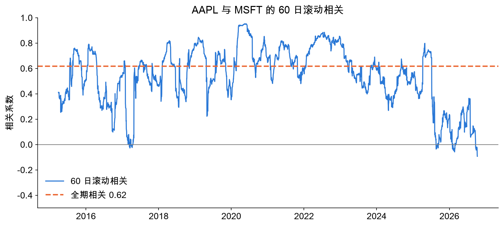
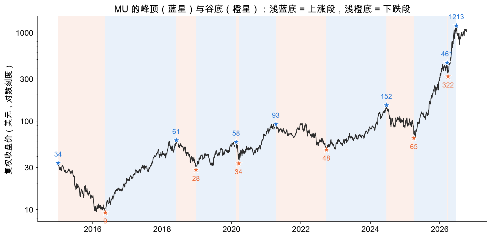

# Risk, Return and Cycles in US Tech Stocks, 2015–2026

**Yu (Cyrus) Chen** · October 2026 ·
[Live dashboard](https://cyrus-mag7-dashboard.streamlit.app/) · [Code](https://github.com/CyrusChan22/mag7-stock-dashboard)

Data: daily adjusted prices from Yahoo Finance, 2 January 2015 to 9 October 2026, for the "Magnificent 7"
(AAPL, MSFT, NVDA, GOOGL, AMZN, META, TSLA), three memory-chip stocks (MU, WDC, SNDK) and three ETFs (SPY, QQQ, SOXX).
All figures are historical; none of this is a forecast or investment advice.

## Summary

1. **Every Mag 7 stock beat the S&P 500, but at a price.** All seven returned 21–69% a year against 14% for SPY,
   and every one of them suffered a drawdown of at least 37%, against 34% for SPY.
2. **Daily returns are not normal.** Extreme days happen far more often than a bell curve predicts. SPY fell more than 5%
   on 6 days; a normal distribution with the same mean and volatility expects 0.007 such days.
3. **Diversification within the Mag 7 is weaker than it looks.** Pairwise correlations are moderate (0.34–0.64),
   but they jump in a sell-off: the 60-day correlation between AAPL and MSFT reached 0.95 around the 2020 crash.
4. **A simple trend rule did not beat buy-and-hold.** A 50/200-day moving-average crossover earned less on all
   9 tickers tested, though it cut the worst drawdown on 7 of them.
5. **Memory chips are still cyclical.** Micron's 2025–26 rally was the largest of the six cycles since 2015
   (7.1x in 11 months), yet it was followed by a 39% fall within five weeks, in line with past downturns.

## 1. Questions and approach

The project asks four questions:

- How do the largest US tech stocks trade off return against risk?
- Do their daily returns behave like a normal distribution, as many textbook models assume?
- How closely do they move together, and with the market?
- Can a simple, rules-based strategy beat buying and holding?

A fifth question came from my own interest in memory chips: after the AI-driven rally of 2025–26,
are memory-chip stocks still cyclical?

The pipeline downloads prices with `yfinance`, stores them in MySQL (two tables, 35,930 daily rows),
and analyses them with Pandas and SciPy. Before analysis, a check script looked for missing values,
impossible prices and daily moves above 20%. All 16 large moves except one were genuine market events.
The exception was SNDK's "when-issued" trading before its spin-off from Western Digital, which I removed.
All returns use prices adjusted for splits and dividends.

## 2. Risk and return

| | Annual return | Annual volatility | Max drawdown | Sharpe ratio |
|---|---|---|---|---|
| NVDA | 69.1% | 48.0% | −66.3% | 1.40 |
| TSLA | 32.1% | 57.0% | −73.6% | 0.53 |
| AMZN | 27.3% | 33.1% | −56.1% | 0.77 |
| AAPL | 25.1% | 28.7% | −38.5% | 0.81 |
| MSFT | 24.8% | 27.6% | −37.1% | 0.83 |
| GOOGL | 24.7% | 29.0% | −44.3% | 0.78 |
| META | 20.9% | 38.0% | −76.7% | 0.50 |
| QQQ | 19.3% | 21.9% | −35.1% | 0.79 |
| SPY | 13.9% | 17.5% | −33.7% | 0.68 |

*Sharpe ratio = (annual return − 2%) / annual volatility.*

NVDA stands out: $1 invested in January 2015 grew to about $476. But a high return did not always mean a good
trade-off. TSLA returned more than twice as much as SPY, yet its Sharpe ratio (0.53) was lower than SPY's (0.68)
because its volatility was more than three times higher. META's 77% drawdown in 2021–22 shows how much an investor
had to sit through even in a stock that ended up well ahead.

## 3. Are returns normal?

Every ticker has positive excess kurtosis, from 1.8 (SNDK) to 18.8 (META): returns cluster tightly around zero
most of the time but have far more extreme days than a normal distribution allows. SPY, often thought of
as the "safe" choice, has an excess kurtosis of 14.1.

This matters for risk measurement. At the 99% level, the historical one-day Value at Risk for SPY is −3.1%,
while the normal-distribution estimate is only −2.5%. A risk model built on the normal assumption would
understate how bad a bad day can get, and the gap widens the further into the tail one looks.

## 4. How the stocks move together

Pairwise correlations among the Mag 7 range from 0.34 (META–TSLA) to 0.64 (MSFT–GOOGL). TSLA is the least
connected to the rest, which fits its different business.

Correlation is not stable, though. AAPL and MSFT have a full-period correlation of 0.62, but their 60-day
rolling correlation reached 0.95 in the window covering the March 2020 crash, and was slightly negative
at the end of the sample in October 2026. Diversification tends to disappear exactly when it is needed most.

Regressing each stock's daily returns on SPY's (a CAPM regression) gives every Mag 7 stock a beta above 1,
from 1.15 (GOOGL) to 1.77 (NVDA): on average they amplified market moves. R² separates market-driven from
company-driven risk. For MSFT, 56% of daily variation is explained by the market; for TSLA only 24%,
so most of TSLA's risk comes from the company itself.

## 5. Can a simple rule beat buy-and-hold?

**Backtest 1: moving-average crossover.** Hold the stock when its 50-day moving average is above its 200-day average,
otherwise hold cash. To avoid look-ahead bias, a signal computed from today's close is applied from the next trading day.
Each trade costs 0.1%. Both the strategy and buy-and-hold start on the same day.

| | Strategy return | Buy & hold return | Strategy drawdown | Buy & hold drawdown |
|---|---|---|---|---|
| SPY | 9.6% | 14.9% | −33.7% | −33.7% |
| NVDA | 69.7% | 70.3% | −37.6% | −66.3% |
| META | 16.5% | 20.0% | −38.3% | −76.7% |
| TSLA | 15.9% | 34.3% | −65.2% | −73.6% |
| AAPL | 16.2% | 26.8% | −45.7% | −38.5% |

*Annual returns and maximum drawdowns for five of the nine tickers tested; QQQ, MSFT, GOOGL and AMZN follow the same pattern.
The period starts in October 2015, when the 200-day average first exists, so buy-and-hold figures differ slightly from Section 2.*

The strategy earned less on all nine tickers. It buys late and sells late, so it misses part of every rally.
Its value was in avoiding long bear markets: it reduced the maximum drawdown on 7 of 9 tickers, nearly halving
it for NVDA and META. It could not help in a crash as fast as March 2020 (SPY's drawdown is unchanged),
and in choppy markets it was whipsawed: AAPL's drawdown got worse and TSLA traded 24 times.
I used the standard 50/200 windows rather than tuning them, because windows chosen to fit past data would overstate
how well the rule works.

**Backtest 2: equal-weight Mag 7.** Holding 1/7 in each stock and rebalancing monthly turned $1 into $36,
against $4.7 for SPY, with a Sharpe ratio of 1.22 against 0.69.

This result should not be read as a strategy. The "Magnificent 7" label was coined in 2023, with hindsight, for the biggest
winners of the decade. An investor in 2015 could not have known to pick them, so the backtest is inflated by
survivorship bias.

## 6. Memory chips: still a cyclical industry?

Memory-chip prices have historically moved in boom-and-bust cycles. To test whether that is still true,
I identified turning points in Micron's (MU) price with a threshold rule: a trough is confirmed once the price
has risen 50% from its low, and a peak once it has fallen 30% from its high. A cycle runs from trough to peak
to the next trough.

Since 2015 MU has gone through six cycles. In each of the first four, it rose 2.1–6.6x over 13–25 months
and then fell 43–58%. The rally that began in April 2025 is the largest in the sample: 7.1x in 11 months.
Counting a 30% pull-back in March 2026 as a pause, MU rose about 19x in 15 months, to a peak of $1,213 in June 2026.

But the swings have not gone away. Within five weeks of that peak MU had fallen 39%, inside the range of past
downturns. On 9 October 2026 it was 15% below the peak, and the rule had not yet confirmed a trough.
MU's risk profile also looks like a cyclical stock's: annual volatility of 52%, three times SPY's, a beta of 1.70,
but an R² of only 0.33. Two-thirds of its daily movement is not explained by the market, which is consistent with
an industry that has its own cycle.

My conclusion is that the data shows this upswing is unusually large, not that memory chips have escaped the cycle.

## 7. Limitations

- **Survivorship bias** in the choice of the Mag 7 (Section 5).
- **Small samples for cycles.** Depending on the thresholds there are only 4 to 8 MU cycles. Results are sensitive to
  the thresholds: the March 2026 fall was −30.3%, so a 31% threshold merges two cycles into one. The two main findings
  (the 2025–26 rally is the largest; it was still followed by a deep fall) hold for every combination I tested
  (rises of 40–80%, falls of 25–40%), and the dashboard lets readers change the thresholds themselves.
- **Turning points are known only after the fact.** A peak is confirmed only once the price has already fallen 30%,
  so the method describes history and cannot be used as a trading signal.
- **Short histories.** SNDK has traded only since February 2025; its annualized figures are not meaningful.
- **Simplifications.** A constant 2% risk-free rate, trades filled at the close with a flat 0.1% cost,
  and CAPM regressions on raw rather than excess returns.

## 8. What I would do next

- Test the moving-average rule out of sample: choose windows on 2015–2020 data and evaluate them on 2021–2026.
- Replace the hindsight Mag 7 with a rule an investor could have followed at the time, such as the ten largest
  US stocks at the start of each year.
- Extend the memory-chip analysis back to the 1990s to get more cycles, and add industry data such as DRAM prices.

The interactive dashboard lets readers rerun every analysis in this report with their own choice of stocks,
dates, moving-average windows and cycle thresholds: <https://cyrus-mag7-dashboard.streamlit.app/>
